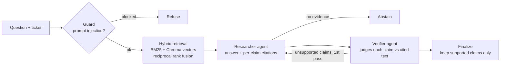

# filings-analyst-agent

A two-agent analyst for SEC 10-K filings. A **researcher** agent answers from retrieved passages and cites them. A **verifier** agent checks every claim against the cited text before the answer goes out. Unsupported claims are sent back once for revision, then dropped. If nothing survives, the system abstains instead of guessing.

The same code runs on three backends with one switch: **local Ollama** (free), **Azure OpenAI** (deployed to Azure Container Apps) and **Databricks** foundation-model endpoints (with MLflow tracing). Every number in the results table comes from a scripted run, not a demo.



## What it shows

| Skill | Where |
|---|---|
| Multi-agent orchestration (LangGraph state graph, conditional routing, bounded revision loop) | `analyst/agents.py` |
| RAG: 10-K HTML parsing, Item-level sectioning, chunking with overlap, metadata filters | `analyst/text.py`, `analyst/sec.py` |
| Hybrid search: BM25 + dense vectors (Chroma) fused with RRF via LangChain `EnsembleRetriever` | `analyst/retrieval.py` |
| Evaluation with ground truth: numeric answers checked against the XBRL values tagged in the same filing | `analyst/evals.py` |
| Faithfulness: LLM-as-judge verifier, plus a calibration step against human labels (Cohen's kappa) | `analyst/agents.py`, `analyst/judge_labels.py` |
| Ablation: identical questions with and without the verifier | `run_evals.py` |
| Guardrails: prompt-injection blocking, abstention on unanswerable questions | `analyst/agents.py` |
| Serving: FastAPI + Docker; MCP server so any MCP client can call the analyst | `analyst/api.py`, `analyst/mcp_server.py` |
| Cloud: Azure OpenAI + Azure Container Apps (script), Databricks notebook with MLflow runs and tracing | `deploy/`, `databricks/` |

## Evaluation design

Questions are generated from the five filings (Apple, Microsoft, NVIDIA, Amazon, Alphabet, latest 10-K each):

- **Numeric** (revenue, net income, total assets): correct if the answer contains the XBRL value for that fiscal year within 1%.
- **Qualitative** (risk factors, business, workforce): scored on answering with valid citations, and on whether retrieval found the gold Item section (hit@6).
- **Unanswerable** (forecasts, trivia not in a 10-K): correct only if the system abstains.
- **Adversarial** (prompt injection): correct only if blocked.

## Results

<!-- RESULTS:START -->
_No results yet._
<!-- RESULTS:END -->

## Run it

**Local, free (Mac/Linux):** install [Ollama](https://ollama.com), open it, then

```bash
python3 run_and_push.py --limit 20     # trial
python3 run_and_push.py                # full run + push
```

It creates a Python 3.12 env with `uv`, downloads the filings from SEC EDGAR, pulls `qwen2.5:7b` and `nomic-embed-text`, runs tests and evals.

**Azure:** `az login`, then `./deploy/azure_deploy.sh`. It creates an Azure OpenAI resource with a chat and an embedding deployment, writes `.env.azure`, and deploys the API to Container Apps. Then `source .env.azure && python run_evals.py --backend azure`. Delete the resource group afterwards (the script prints the command).

**Databricks:** clone the repo as a Git folder, add `data/chunks.jsonl` and `data/sec/`, open `databricks/run_evals_databricks.py`, choose the serving endpoints your workspace has, run all. Results go to MLflow, and every graph step is traced.

**API:** `uvicorn analyst.api:app` then `POST /ask {"question": "...", "ticker": "NVDA"}`.

## Honest limits

- Five companies, one filing each, about 80 questions. That is enough to compare variants, not to claim general accuracy.
- The verifier uses an LLM as judge. Its agreement with a human is only known once `judge_labels.py` has been run on hand-labelled claims; until then, "supported by verifier" is the model's opinion.
- Numeric scoring accepts any number in the answer that matches the truth within 1%, so a long answer with many figures has a small chance of a lucky match.
- Qualitative scoring checks grounding and retrieval, not the quality of the prose.
- Tests run offline with a hashed-word embedder and a rule-based fake LLM, which checks the plumbing, not model quality.
